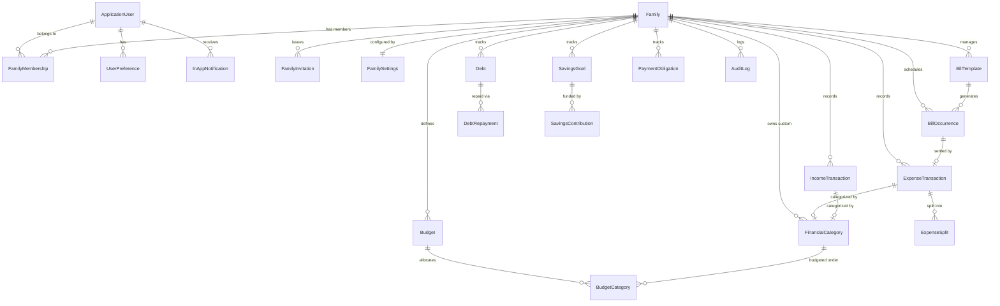

# Family Budget Manager — Database Design & Entity Architecture

## 1. Overview
The database for Family Budget Manager is designed with strict relational integrity, multi-tenant isolation per `FamilyId`, precision monetary data types (`decimal(18,2)`), audit tracking, and indexes aligned with high-frequency dashboard queries.

Supported RDBMS:
- **SQLite 3 (Development, CI/CD, Local Deployments):** Foreign keys enabled (`PRAGMA foreign_keys = ON`), WAL journal mode for concurrent reading/writing.
- **SQL Server 2019+ / Azure SQL / PostgreSQL 14+ (Production):** High scalability, column-level security, automated backup support.

---

## 2. Entity Relationship Model

---

## 3. Data Dictionary & Table Schemas

### 3.1. Identity & Tenant Tables

#### `AspNetUsers` (`ApplicationUser`)
| Column | Type | Nullable | Description |
|---|---|---|---|
| `Id` | `NVARCHAR(450)` | NO | Primary Key (GUID) |
| `FullName` | `NVARCHAR(150)` | NO | User's full legal name |
| `DisplayName` | `NVARCHAR(100)` | YES | Preferred UI display name |
| `Email` | `NVARCHAR(256)` | NO | Unique login email address |
| `AvatarUrl` | `NVARCHAR(500)` | YES | Path/URL to user profile picture |
| `CreatedAt` | `DATETIME2` | NO | UTC registration timestamp |
| `IsActive` | `BIT` | NO | Account active flag |

#### `Families`
| Column | Type | Nullable | Description |
|---|---|---|---|
| `Id` | `NVARCHAR(450)` | NO | Primary Key (GUID) |
| `Name` | `NVARCHAR(120)` | NO | Family household name (e.g., "Sharma Household") |
| `CurrencyCode` | `NVARCHAR(10)` | NO | Currency standard code (Default: "INR") |
| `CurrencySymbol` | `NVARCHAR(5)` | NO | Currency symbol (Default: "₹") |
| `Country` | `NVARCHAR(80)` | NO | Country name |
| `TimeZoneId` | `NVARCHAR(80)` | NO | Standard IANA / Windows TimeZone Id |
| `MonthStartDay` | `INT` | NO | Budget month starting day (1-28, default 1) |
| `MonthlyBudget` | `DECIMAL(18,2)` | YES | Optional overall monthly household budget |
| `Description` | `NVARCHAR(500)` | YES | Optional household description |
| `CreatedByUserId` | `NVARCHAR(450)` | NO | FK -> `AspNetUsers.Id` |
| `CreatedAt` | `DATETIME2` | NO | UTC timestamp |
| `IsActive` | `BIT` | NO | Soft-deletion flag |

#### `FamilyMemberships`
| Column | Type | Nullable | Description |
|---|---|---|---|
| `Id` | `NVARCHAR(450)` | NO | Primary Key |
| `FamilyId` | `NVARCHAR(450)` | NO | FK -> `Families.Id` (Cascade delete) |
| `UserId` | `NVARCHAR(450)` | NO | FK -> `AspNetUsers.Id` (Restrict) |
| `Role` | `INT` | NO | Enum: 1=Owner, 2=Admin, 3=Member, 4=Viewer |
| `JoinedAt` | `DATETIME2` | NO | UTC join date |
| `AllocatedPersonalBudget`| `DECIMAL(18,2)`| YES | Optional personal monthly spending allowance |
| `CanApproveExpenses` | `BIT` | NO | Granular permission flag |
| `CanManageBills` | `BIT` | NO | Granular permission flag |
| `CanViewDebts` | `BIT` | NO | Granular permission flag |
| `CanExportReports` | `BIT` | NO | Granular permission flag |
| `IsActive` | `BIT` | NO | Membership active status |
*Unique Index: `(FamilyId, UserId)`*

#### `FamilyInvitations`
| Column | Type | Nullable | Description |
|---|---|---|---|
| `Id` | `NVARCHAR(450)` | NO | Primary Key |
| `FamilyId` | `NVARCHAR(450)` | NO | FK -> `Families.Id` |
| `InvitedEmail` | `NVARCHAR(256)` | NO | Target invitee email |
| `InvitedRole` | `INT` | NO | Proposed Role Enum |
| `TokenHash` | `NVARCHAR(128)` | NO | SHA-256 cryptographically secure token hash |
| `CreatedAt` | `DATETIME2` | NO | Creation timestamp |
| `ExpiresAt` | `DATETIME2` | NO | Expiration timestamp (e.g. +7 days) |
| `InvitedByUserId`| `NVARCHAR(450)` | NO | FK -> `AspNetUsers.Id` |
| `Status` | `INT` | NO | Enum: 0=Pending, 1=Accepted, 2=Expired, 3=Revoked |
| `AcceptedByUserId` | `NVARCHAR(450)`| YES | FK -> `AspNetUsers.Id` |
| `AcceptedAt` | `DATETIME2` | YES | Acceptance timestamp |

---

### 3.2. Financial Categories & Transactions

#### `FinancialCategories`
| Column | Type | Nullable | Description |
|---|---|---|---|
| `Id` | `NVARCHAR(450)` | NO | Primary Key |
| `FamilyId` | `NVARCHAR(450)` | YES | FK -> `Families.Id` (NULL = global system category) |
| `Name` | `NVARCHAR(100)` | NO | Category name (e.g. "Groceries", "Fuel") |
| `Description` | `NVARCHAR(250)` | YES | Description |
| `ColorHex` | `NVARCHAR(20)` | NO | Hex color code for badges/charts (e.g., "#10B981") |
| `IconClass` | `NVARCHAR(50)` | NO | Bootstrap icon class (e.g., "bi-cart-check") |
| `Type` | `INT` | NO | Enum: 1=Expense, 2=Income |
| `IsSystemDefault` | `BIT` | NO | True for pre-seeded system defaults |
| `IsActive` | `BIT` | NO | Active status |

#### `ExpenseTransactions`
| Column | Type | Nullable | Description |
|---|---|---|---|
| `Id` | `NVARCHAR(450)` | NO | Primary Key |
| `FamilyId` | `NVARCHAR(450)` | NO | FK -> `Families.Id` (Tenant key) |
| `Title` | `NVARCHAR(150)` | NO | Expense title |
| `Amount` | `DECIMAL(18,2)` | NO | Monetary amount (Strictly positive) |
| `CategoryId` | `NVARCHAR(450)` | NO | FK -> `FinancialCategories.Id` |
| `PaidByMemberId` | `NVARCHAR(450)` | NO | FK -> `FamilyMemberships.Id` |
| `ExpenseDate` | `DATETIME2` | NO | Date of expense incurred |
| `PaymentMethod` | `NVARCHAR(50)` | NO | Cash, UPI, Credit Card, Debit Card, Net Banking |
| `MerchantOrShop` | `NVARCHAR(120)` | YES | Merchant name (e.g., "Amazon", "Local Mart") |
| `Notes` | `NVARCHAR(1000)`| YES | Detailed notes |
| `ReceiptPath` | `NVARCHAR(500)` | YES | Relative path to uploaded receipt image/pdf |
| `Tags` | `NVARCHAR(200)` | YES | Comma-separated tags |
| `Status` | `INT` | NO | Enum: 1=Confirmed, 2=PendingApproval, 3=Rejected, 4=Reversed |
| `IsApproved` | `BIT` | NO | Approval status |
| `ApprovedByUserId`| `NVARCHAR(450)` | YES | FK -> `AspNetUsers.Id` |
| `CreatedByUserId`| `NVARCHAR(450)` | NO | FK -> `AspNetUsers.Id` |
| `CreatedAt` | `DATETIME2` | NO | Created timestamp |
| `UpdatedAt` | `DATETIME2` | YES | Last updated timestamp |
*Indexes: `(FamilyId, ExpenseDate)`, `(FamilyId, CategoryId)`, `(PaidByMemberId)`*

#### `ExpenseSplits`
| Column | Type | Nullable | Description |
|---|---|---|---|
| `Id` | `NVARCHAR(450)` | NO | Primary Key |
| `ExpenseTransactionId`| `NVARCHAR(450)`| NO | FK -> `ExpenseTransactions.Id` (Cascade delete) |
| `BeneficiaryMemberId` | `NVARCHAR(450)`| NO | FK -> `FamilyMemberships.Id` |
| `SplitType` | `INT` | NO | Enum: 1=Equal, 2=FixedAmount, 3=Percentage |
| `SplitAmount` | `DECIMAL(18,2)` | NO | Beneficiary allocated amount |
| `SplitPercentage` | `DECIMAL(5,2)` | YES | Percentage if applicable |
| `Notes` | `NVARCHAR(200)` | YES | Split notes |

#### `IncomeTransactions`
| Column | Type | Nullable | Description |
|---|---|---|---|
| `Id` | `NVARCHAR(450)` | NO | Primary Key |
| `FamilyId` | `NVARCHAR(450)` | NO | FK -> `Families.Id` |
| `Title` | `NVARCHAR(150)` | NO | Income title |
| `Amount` | `DECIMAL(18,2)` | NO | Monetary amount |
| `IncomeSource` | `NVARCHAR(60)` | NO | Salary, Freelance, Business, Rental, Dividend, Gift, Other |
| `RecipientMemberId`| `NVARCHAR(450)` | NO | FK -> `FamilyMemberships.Id` |
| `DateReceived` | `DATETIME2` | NO | Date funds received |
| `PaymentMethod` | `NVARCHAR(50)` | NO | Bank Transfer, Cash, Cheque, Direct Deposit |
| `CategoryId` | `NVARCHAR(450)` | YES | FK -> `FinancialCategories.Id` |
| `AccountOrSource` | `NVARCHAR(100)` | YES | Deposited account identifier |
| `Notes` | `NVARCHAR(1000)`| YES | Income details |
| `AttachmentPath` | `NVARCHAR(500)` | YES | File attachment path |
| `IsRecurring` | `BIT` | NO | Flag indicating repeating income |
| `Status` | `INT` | NO | Enum: 1=Confirmed, 2=Pending, 3=Reversed |
| `CreatedByUserId` | `NVARCHAR(450)` | NO | FK -> `AspNetUsers.Id` |
| `CreatedAt` | `DATETIME2` | NO | Timestamp |
*Indexes: `(FamilyId, DateReceived)`, `(RecipientMemberId)`*

---

### 3.3. Budgets & Savings Goals

#### `Budgets`
| Column | Type | Nullable | Description |
|---|---|---|---|
| `Id` | `NVARCHAR(450)` | NO | Primary Key |
| `FamilyId` | `NVARCHAR(450)` | NO | FK -> `Families.Id` |
| `PeriodYear` | `INT` | NO | Year (e.g., 2026) |
| `PeriodMonth` | `INT` | NO | Month (1-12) |
| `TotalPlannedBudget`| `DECIMAL(18,2)`| NO | Overall household monthly cap |
| `RolloverAmount` | `DECIMAL(18,2)`| NO | Unused amount rolled over from prior month |
| `Notes` | `NVARCHAR(500)` | YES | Budget notes |
| `CreatedAt` | `DATETIME2` | NO | Creation date |
*Unique Index: `(FamilyId, PeriodYear, PeriodMonth)`*

#### `BudgetCategories`
| Column | Type | Nullable | Description |
|---|---|---|---|
| `Id` | `NVARCHAR(450)` | NO | Primary Key |
| `BudgetId` | `NVARCHAR(450)` | NO | FK -> `Budgets.Id` (Cascade delete) |
| `CategoryId` | `NVARCHAR(450)` | NO | FK -> `FinancialCategories.Id` |
| `PlannedAmount` | `DECIMAL(18,2)` | NO | Category planned allocation |
| `Notes` | `NVARCHAR(200)` | YES | Category note |
*Unique Index: `(BudgetId, CategoryId)`*

#### `SavingsGoals`
| Column | Type | Nullable | Description |
|---|---|---|---|
| `Id` | `NVARCHAR(450)` | NO | Primary Key |
| `FamilyId` | `NVARCHAR(450)` | NO | FK -> `Families.Id` |
| `Title` | `NVARCHAR(120)` | NO | Goal name (e.g. "Emergency Fund", "House Downpayment") |
| `TargetAmount` | `DECIMAL(18,2)` | NO | Total savings target |
| `CurrentAmount` | `DECIMAL(18,2)` | NO | Accumulated amount |
| `TargetDate` | `DATETIME2` | YES | Target completion date |
| `Category` | `NVARCHAR(60)` | YES | E.g. "Emergency", "Vacation", "Education" |
| `Status` | `INT` | NO | Enum: 1=Active, 2=Achieved, 3=Paused |
| `CreatedByUserId` | `NVARCHAR(450)` | NO | FK -> `AspNetUsers.Id` |
| `CreatedAt` | `DATETIME2` | NO | Timestamp |

#### `SavingsContributions`
| Column | Type | Nullable | Description |
|---|---|---|---|
| `Id` | `NVARCHAR(450)` | NO | Primary Key |
| `SavingsGoalId` | `NVARCHAR(450)` | NO | FK -> `SavingsGoals.Id` (Cascade delete) |
| `MemberId` | `NVARCHAR(450)` | NO | FK -> `FamilyMemberships.Id` |
| `Amount` | `DECIMAL(18,2)` | NO | Contributed amount |
| `ContributionDate`| `DATETIME2` | NO | Date |
| `Notes` | `NVARCHAR(300)` | YES | Notes |

---

### 3.4. Debts, Borrowing, & Repayments

#### `Debts`
| Column | Type | Nullable | Description |
|---|---|---|---|
| `Id` | `NVARCHAR(450)` | NO | Primary Key |
| `FamilyId` | `NVARCHAR(450)` | NO | FK -> `Families.Id` |
| `DebtType` | `INT` | NO | Enum: 1=MoneyBorrowed (Liability), 2=MoneyLent (Receivable) |
| `CreditorOrDebtorName`| `NVARCHAR(150)`| NO | External party name or entity |
| `LinkedMemberId` | `NVARCHAR(450)` | YES | FK -> `FamilyMemberships.Id` (Family debtor/creditor) |
| `OriginalPrincipal`| `DECIMAL(18,2)`| NO | Initial principal amount |
| `CurrentBalance` | `DECIMAL(18,2)` | NO | Remaining unpaid principal |
| `CurrencyCode` | `NVARCHAR(10)` | NO | Currency |
| `StartDate` | `DATETIME2` | NO | Date loan initiated |
| `DueDate` | `DATETIME2` | YES | Date final balance is due |
| `InterestRate` | `DECIMAL(6,3)` | YES | Annual interest rate percentage (if any) |
| `InterestType` | `INT` | NO | Enum: 0=None, 1=SimpleInterest |
| `RepaymentFrequency`| `NVARCHAR(30)` | YES | Monthly, One-Time, Flexible |
| `InstallmentAmount`| `DECIMAL(18,2)` | YES | Suggested installment amount |
| `Notes` | `NVARCHAR(1000)`| YES | Terms and agreement notes |
| `DocumentPath` | `NVARCHAR(500)` | YES | Agreement document attachment |
| `Status` | `INT` | NO | Enum: 1=Active, 2=PartiallyRepaid, 3=PaidOff, 4=Overdue, 5=Cancelled |
| `CreatedByUserId` | `NVARCHAR(450)` | NO | Creator FK |
| `CreatedAt` | `DATETIME2` | NO | Timestamp |

#### `DebtRepayments`
| Column | Type | Nullable | Description |
|---|---|---|---|
| `Id` | `NVARCHAR(450)` | NO | Primary Key |
| `DebtId` | `NVARCHAR(450)` | NO | FK -> `Debts.Id` (Cascade delete) |
| `RepaidByMemberId`| `NVARCHAR(450)` | YES | FK -> `FamilyMemberships.Id` |
| `Amount` | `DECIMAL(18,2)` | NO | Total payment amount |
| `PrincipalPortion`| `DECIMAL(18,2)`| NO | Amount applied toward principal |
| `InterestPortion` | `DECIMAL(18,2)`| NO | Amount applied toward interest |
| `PaymentDate` | `DATETIME2` | NO | Date of repayment |
| `PaymentMethod` | `NVARCHAR(50)` | NO | UPI, Bank, Cash, etc. |
| `ReferenceNumber` | `NVARCHAR(100)` | YES | Transaction receipt or UTR |
| `Notes` | `NVARCHAR(500)` | YES | Notes |

---

### 3.5. Recurring Bills & Pending Obligations

#### `BillTemplates`
| Column | Type | Nullable | Description |
|---|---|---|---|
| `Id` | `NVARCHAR(450)` | NO | Primary Key |
| `FamilyId` | `NVARCHAR(450)` | NO | FK -> `Families.Id` |
| `BillName` | `NVARCHAR(120)` | NO | Bill title (e.g., "Airtel Fiber Broadband") |
| `CategoryId` | `NVARCHAR(450)` | NO | FK -> `FinancialCategories.Id` |
| `Payee` | `NVARCHAR(120)` | NO | Biller / Service Provider name |
| `ExpectedAmount` | `DECIMAL(18,2)` | NO | Default expected cost |
| `IsVariableAmount`| `BIT` | NO | True if amount fluctuates (e.g., Electricity) |
| `Frequency` | `INT` | NO | Enum: 1=Weekly, 2=Monthly, 3=Quarterly, 4=HalfYearly, 5=Annually |
| `BillingStartDate`| `DATETIME2` | NO | First billing cycle date |
| `NextDueDate` | `DATETIME2` | NO | Upcoming scheduled due date |
| `EndDate` | `DATETIME2` | YES | Optional contract termination date |
| `ResponsibleMemberId`| `NVARCHAR(450)`| YES | FK -> `FamilyMemberships.Id` |
| `AutopayEnabled` | `BIT` | NO | Informational indicator |
| `Notes` | `NVARCHAR(500)` | YES | Bill description |
| `IsActive` | `BIT` | NO | Active status (can be paused) |

#### `BillOccurrences`
| Column | Type | Nullable | Description |
|---|---|---|---|
| `Id` | `NVARCHAR(450)` | NO | Primary Key |
| `BillTemplateId` | `NVARCHAR(450)` | NO | FK -> `BillTemplates.Id` (Cascade delete) |
| `FamilyId` | `NVARCHAR(450)` | NO | FK -> `Families.Id` |
| `DueDate` | `DATETIME2` | NO | Specific cycle due date |
| `ExpectedAmount` | `DECIMAL(18,2)` | NO | Expected bill amount |
| `ActualAmountPaid`| `DECIMAL(18,2)`| NO | Total paid so far (default 0) |
| `Status` | `INT` | NO | Enum: 1=Pending, 2=Paid, 3=PartiallyPaid, 4=Skipped, 5=Overdue |
| `PaidDate` | `DATETIME2` | YES | Date settlement completed |
| `ExpenseTransactionId`| `NVARCHAR(450)`| YES | FK -> `ExpenseTransactions.Id` (Settlement link) |
| `Notes` | `NVARCHAR(300)` | YES | Cycle notes |
*Unique Index: `(BillTemplateId, DueDate)` (guarantees idempotent generation)*

#### `PaymentObligations`
| Column | Type | Nullable | Description |
|---|---|---|---|
| `Id` | `NVARCHAR(450)` | NO | Primary Key |
| `FamilyId` | `NVARCHAR(450)` | NO | FK -> `Families.Id` |
| `Title` | `NVARCHAR(150)` | NO | Obligation title |
| `AmountDue` | `DECIMAL(18,2)` | NO | Total due |
| `AmountPaid` | `DECIMAL(18,2)` | NO | Amount paid to date |
| `DueDate` | `DATETIME2` | NO | Payment deadline |
| `ResponsibleMemberId`| `NVARCHAR(450)`| YES | FK -> `FamilyMemberships.Id` |
| `PayeeName` | `NVARCHAR(150)` | NO | Entity or member owed money |
| `ObligationType` | `INT` | NO | Enum: 1=Bill, 2=MemberReimbursement, 3=PersonalDebt, 4=HouseholdExpense, 5=Other |
| `RelatedBillOccurrenceId`| `NVARCHAR(450)`| YES | FK -> `BillOccurrences.Id` |
| `RelatedExpenseId`| `NVARCHAR(450)`| YES | FK -> `ExpenseTransactions.Id` |
| `RelatedDebtId` | `NVARCHAR(450)` | YES | FK -> `Debts.Id` |
| `Priority` | `INT` | NO | Enum: 1=Low, 2=Medium, 3=High, 4=Urgent |
| `Status` | `INT` | NO | Enum: 1=Pending, 2=PartiallyPaid, 3=Paid, 4=Overdue, 5=Cancelled |
| `Notes` | `NVARCHAR(500)` | YES | Details |
| `CreatedAt` | `DATETIME2` | NO | Timestamp |

---

### 3.6. Notifications, Audit Logs, & Preferences

#### `InAppNotifications`
| Column | Type | Nullable | Description |
|---|---|---|---|
| `Id` | `NVARCHAR(450)` | NO | Primary Key |
| `UserId` | `NVARCHAR(450)` | NO | FK -> `AspNetUsers.Id` |
| `FamilyId` | `NVARCHAR(450)` | YES | FK -> `Families.Id` |
| `Title` | `NVARCHAR(150)` | NO | Notification headline |
| `Message` | `NVARCHAR(500)` | NO | Notification body text |
| `NotificationType`| `INT` | NO | Enum: 1=BillReminder, 2=BudgetAlert, 3=DebtDue, 4=Invitation, 5=ExpenseAdded, 6=System |
| `DeepLinkUrl` | `NVARCHAR(250)` | YES | Relative navigation target |
| `IsRead` | `BIT` | NO | Read indicator (default false) |
| `ReadAt` | `DATETIME2` | YES | Timestamp when read |
| `CreatedAt` | `DATETIME2` | NO | Timestamp |

#### `AuditLogs`
| Column | Type | Nullable | Description |
|---|---|---|---|
| `Id` | `NVARCHAR(450)` | NO | Primary Key |
| `FamilyId` | `NVARCHAR(450)` | YES | FK -> `Families.Id` |
| `UserId` | `NVARCHAR(450)` | YES | FK -> `AspNetUsers.Id` |
| `ActionType` | `NVARCHAR(50)` | NO | CREATE, UPDATE, DELETE, REVERSE, APPROVE, INVITE |
| `EntityName` | `NVARCHAR(60)` | NO | Table/Entity modified |
| `EntityId` | `NVARCHAR(100)` | NO | Identifier of modified record |
| `Details` | `NVARCHAR(MAX)` | YES | JSON delta or human-readable explanation |
| `IpAddress` | `NVARCHAR(45)` | YES | Client IP address (redacted for privacy) |
| `Timestamp` | `DATETIME2` | NO | UTC audit timestamp |

#### `UserPreferences`
| Column | Type | Nullable | Description |
|---|---|---|---|
| `Id` | `NVARCHAR(450)` | NO | Primary Key |
| `UserId` | `NVARCHAR(450)` | NO | FK -> `AspNetUsers.Id` (Unique) |
| `PreferredTheme` | `NVARCHAR(20)` | NO | "light", "dark", "system" |
| `PreferredCurrency`| `NVARCHAR(10)` | NO | "INR", "USD", etc. |
| `DefaultFamilyId`| `NVARCHAR(450)` | YES | Last active family for auto-switching |
| `EmailNotificationsEnabled`| `BIT`| NO | Email delivery preference |

---

## 4. Multi-Tenant Security & Indexing Rules
1. **Tenant Isolation:** Every financial table references `FamilyId`. All data queries in repositories and services must include `.Where(x => x.FamilyId == activeFamilyId)`.
2. **Foreign Key Restraints:**
   - Deleting a user does NOT delete household financial records (`DeleteBehavior.Restrict`).
   - Removing a family member preserves their historical records with member attribution intact.
3. **Optimistic Concurrency:** RowVersion / UpdatedAt checking on `ExpenseTransaction`, `Debt`, and `Budget` prevents lost updates during concurrent edits.
4. **Audit Immutability:** `AuditLogs` and `DebtRepayments` are append-only ledgers.
