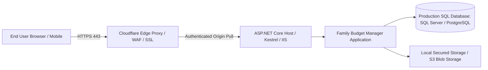

# Family Budget Manager — Production Deployment Guide

This guide details the deployment of the Family Budget Manager ASP.NET Core 8 MVC application on production servers with Cloudflare as the authoritative DNS, TLS, and security proxy.

---

## 1. Hosting Architecture Overview



> **IMPORTANT HOSTING FACT:** Cloudflare Pages and Workers execute JavaScript/WASM in edge isolates and do **not** run standard ASP.NET Core MVC server processes or Kestrel. The ASP.NET Core application must run on a compatible .NET 8 runtime host (Windows Server / IIS, Linux VM with Kestrel + systemd/Nginx, or Container). Cloudflare sits in front as the reverse proxy for DNS, SSL, WAF, rate limiting, and static asset caching.

---

## 2. Server Prerequisites

- **Host Operating System:** Ubuntu 22.04+ LTS, Debian 12+, or Windows Server 2022.
- **Runtime:** .NET 8.0 Runtime or ASP.NET Core 8.0 Hosting Bundle.
- **Reverse Proxy on Host:** Nginx (Linux) or IIS with ASP.NET Core Module (Windows).
- **Database:** Microsoft SQL Server (2019+) or PostgreSQL (14+), or dedicated SQLite file storage on SSD with WAL mode.
- **Edge Proxy:** Cloudflare Free or Pro plan.

---

## 3. Configuration & Secrets Management

Never commit production connection strings or keys to git. Use environment variables or Azure Key Vault / AWS Secrets Manager.

Create an `.env` or production `appsettings.Production.json` file on the deployment server:

```json
{
  "ConnectionStrings": {
    "DefaultConnection": "Server=tcp:sqlserver.internal,1433;Database=FamilyBudgetDb;User Id=fb_app;Password=SuperSecurePassword123!;TrustServerCertificate=False;Encrypt=True;"
  },
  "DatabaseProvider": "SqlServer",
  "AppSettings": {
    "AppBaseUrl": "https://budget.yourfamilydomain.com",
    "DefaultCurrency": "INR",
    "DefaultCurrencySymbol": "₹"
  },
  "EmailSettings": {
    "Provider": "Smtp",
    "SmtpHost": "smtp.sendgrid.net",
    "SmtpPort": 587,
    "SmtpUsername": "apikey",
    "SmtpPassword": "SG.YourSendGridApiKeyHere",
    "SenderEmail": "noreply@yourfamilydomain.com",
    "SenderName": "Family Budget Manager"
  },
  "Storage": {
    "UploadPath": "/var/familybudget/uploads",
    "MaxFileSizeMb": 5
  }
}
```

---

## 4. Linux (Ubuntu / systemd + Nginx) Deployment Steps

### Step 4.1: Publish the .NET Application
```bash
dotnet publish src/FamilyBudget.Web/FamilyBudget.Web.csproj -c Release -o /var/www/familybudget --no-self-contained -r linux-x64
```

### Step 4.2: Configure systemd Service
Create `/etc/systemd/system/familybudget.service`:
```ini
[Unit]
Description=Family Budget Manager Web Application
After=network.target

[Service]
WorkingDirectory=/var/www/familybudget
ExecStart=/usr/bin/dotnet /var/www/familybudget/FamilyBudget.Web.dll
Restart=always
RestartSec=10
KillSignal=SIGINT
SyslogIdentifier=familybudget
User=www-data
Environment=ASPNETCORE_ENVIRONMENT=Production
Environment=DOTNET_PRINT_TELEMETRY_MESSAGE=false

[Install]
WantedBy=multi-user.target
```

Enable and start the service:
```bash
sudo systemctl daemon-reload
sudo systemctl enable familybudget
sudo systemctl start familybudget
```

### Step 4.3: Configure Local Nginx Reverse Proxy
Create `/etc/nginx/sites-available/familybudget`:
```nginx
server {
    listen 80;
    server_name budget.yourfamilydomain.com;
    return 301 https://$host$request_uri;
}

server {
    listen 443 ssl http2;
    server_name budget.yourfamilydomain.com;

    # Cloudflare Origin CA Certificate
    ssl_certificate /etc/ssl/certs/cloudflare_origin.crt;
    ssl_certificate_key /etc/ssl/private/cloudflare_origin.key;
    ssl_protocols TLSv1.2 TLSv1.3;

    # Security Headers
    add_header X-Frame-Options "SAMEORIGIN" always;
    add_header X-Content-Type-Options "nosniff" always;
    add_header Referrer-Policy "strict-origin-when-cross-origin" always;

    client_max_body_size 10M;

    location / {
        proxy_pass http://127.0.0.1:5000;
        proxy_http_version 1.1;
        proxy_set_header Upgrade $http_upgrade;
        proxy_set_header Connection keep-alive;
        proxy_set_header Host $host;
        proxy_cache_bypass $http_upgrade;
        proxy_set_header X-Forwarded-For $proxy_add_x_forwarded_for;
        proxy_set_header X-Forwarded-Proto $scheme;
    }

    # Static assets caching
    location ~* \.(css|js|jpg|jpeg|png|gif|ico|svg|woff|woff2)$ {
        proxy_pass http://127.0.0.1:5000;
        expires 30d;
        add_header Cache-Control "public, no-transform";
    }
}
```

---

## 5. Cloudflare Configuration

1. **DNS Management:**
   - Add an `A` record pointing `budget.yourfamilydomain.com` to your server's public IP.
   - Set proxy status to **Proxied (Orange Cloud)**.
2. **SSL/TLS Encryption Mode:**
   - Select **Full (Strict)**.
   - Generate a free Cloudflare Origin CA certificate and install it in Nginx/IIS as shown above.
3. **Cache Rules (Critical for Financial Privacy):**
   - Create a Page Rule: `*budget.yourfamilydomain.com/css/*` -> Cache Level: **Cache Everything**.
   - Create a Page Rule: `*budget.yourfamilydomain.com/js/*` -> Cache Level: **Cache Everything**.
   - Create a Page Rule: `*budget.yourfamilydomain.com/*` -> Cache Level: **Bypass** (to prevent caching dynamic financial transactions and personalized dashboards).
4. **WAF & Security Rules:**
   - Enable **Browser Integrity Check**.
   - Configure Rate Limiting: 10 requests per minute on `/Account/Login` and `/Account/Register` to block credential stuffing.
   - Restrict TLS versions to TLS 1.2 minimum.

---

## 6. Database Migration Strategy

Before restarting the application on production, run:
```bash
dotnet ef database update --project src/FamilyBudget.Infrastructure --startup-project src/FamilyBudget.Web --connection "$PROD_CONNECTION_STRING"
```

For high-availability zero-downtime environments, generate idempotent SQL scripts:
```bash
dotnet ef migrations script --idempotent -o /deploy/migration.sql --project src/FamilyBudget.Infrastructure --startup-project src/FamilyBudget.Web
```

---

## 7. Automated Backups & Disaster Recovery

### For SQLite:
Run an automated nightly cron job using SQLite's online vacuum backup API:
```bash
sqlite3 /var/www/familybudget/familybudget.db ".backup '/var/backups/familybudget_$(date +%Y%m%d_%H%M%S).db'"
```

### For SQL Server:
```sql
BACKUP DATABASE [FamilyBudgetDb]
TO DISK = N'/var/opt/mssql/backup/FamilyBudgetDb_Daily.bak'
WITH NOFORMAT, NOINIT, NAME = N'FamilyBudgetDb-Full', SKIP, NOREWIND, NOUNLOAD, STATS = 10;
```

---

## 8. Rollback Procedure

If a deployed release encounters issues:
1. Revert the systemd service or container to the previous build artifact:
   ```bash
   sudo systemctl stop familybudget
   cp -r /var/www/familybudget_backup/* /var/www/familybudget/
   sudo systemctl start familybudget
   ```
2. If database schema was altered, apply the inverse migration script or restore from the pre-migration snapshot.
3. Validate application health endpoint: `curl -I https://budget.yourfamilydomain.com/health`.
